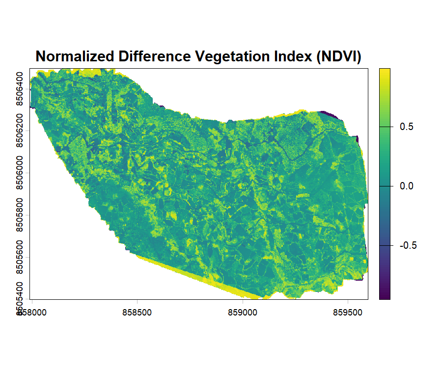
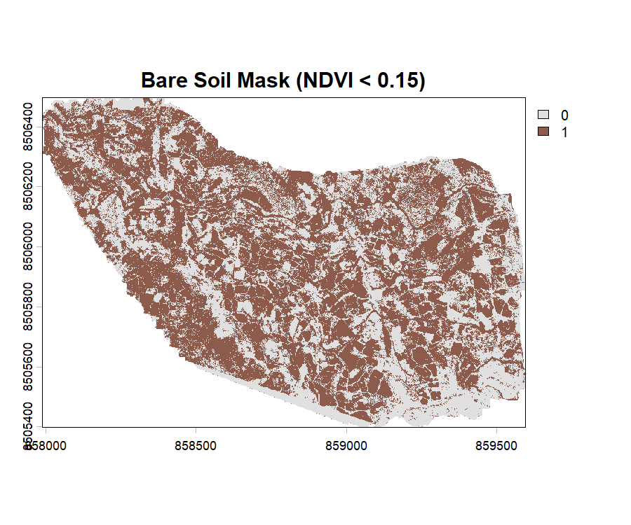

# Interactive Swipe & Visual Analytics

## 1. Overview & Dual-Layer Comparison

In precision spatial epidemiology and micro-environmental surveillance,
field researchers and public health brigades need to contrast physical
landscape features (such as high-resolution UAV orthomosaics or raw
spectral layers) against derived eco-epidemiological indices (e.g., NDVI
vs. Bare Soil, TWI vs. Water, or Orthomosaic vs. IMSR).

`drones4health` provides
**[`d4h_mapview_swipe()`](https://josueflorian17.github.io/drones4health-version-control/reference/d4h_mapview_swipe.md)**,
an interactive side-by-side swipe slider powered by Leaflet and Mapview
swipe mechanics.

### Interactive Live Slider Demo (Leaflet & Mapview Swipe):

    <iframe src="../d4h_swipe_viewer.html" width="100%" height="560px" style="border: none; border-radius: 8px;" title="Interactive Leaflet Swipe Map"></iframe>

------------------------------------------------------------------------

## 2. Interactive In-Browser Swipe Slider

You can render an interactive swipe comparison in your RStudio Viewer,
Shiny dashboard, or R Markdown document:

``` r

library(drones4health)
library(terra)

# 1. Paths to UAV multispectral bands
nir_path <- "data/Ohuay_NIR.tif"
red_path <- "data/Ohuay_R.tif"

# 2. Compute NDVI and Bare Soil mask
r_ndvi <- d4h_ndvi(nir = nir_path, red = red_path)
r_soil <- d4h_bare_soil(ndvi_raster = r_ndvi, threshold = 0.15)

# 3. Interactive swipe slider (Left: NDVI, Right: Bare Soil Mask)
d4h_mapview_swipe(
  x       = r_ndvi,
  y       = r_soil,
  col_x   = "viridis",
  col_y   = c("#f5f5f5", "#8d5b4c"),
  basemap = TRUE
)
```

    
    <p class="small text-muted mt-1"><strong>Left Layer:</strong> NDVI (Vegetation Vigor &amp; Canopy Roosting)</p>

    
    <p class="small text-muted mt-1"><strong>Right Layer:</strong> Bare Soil Mask (&lt; 0.15, Exposed Substrate)</p>

------------------------------------------------------------------------

## 3. Superimposing Surveillance Grids

You can also overlay operational surveillance grids (e.g. 50-meter
hexagonal grids) directly over the swiping layers:

``` r

# Generate 50m operational hexagonal grid
grid_hex <- d4h_hex_grid(aoi = r_ndvi, cell_size = 50)

# Swipe with grid overlay for field brigades
d4h_mapview_swipe(
  x       = r_ndvi,
  y       = r_soil,
  grid    = grid_hex,
  col_x   = "viridis",
  col_y   = c("#f5f5f5", "#8d5b4c")
)
```


*Figure 2: Interactive slider comparison with an operational 50m
hexagonal grid overlay for vector control logistics.*

------------------------------------------------------------------------

## 4. Epidemiological Utility

- **Substrate Validation:** Disentangle bare ground, unpaved pedestrian
  pathways, and cleared peri-domestic clearings from natural vegetation
  without ground-truth ambiguity.
- **Larviciding Planning:** Locate small ditches, water pooling areas,
  and artificial structures across complex rural and peri-urban
  landscapes.
- **Quality Control:** Visually confirm that binary thresholds (e.g.,
  NDVI \< 0.15 for bare soil) accurately conform to real landscape
  features.
