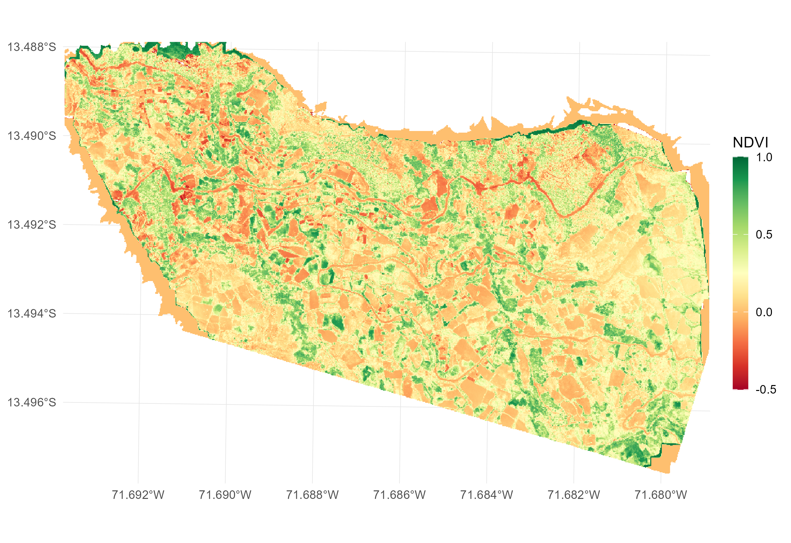
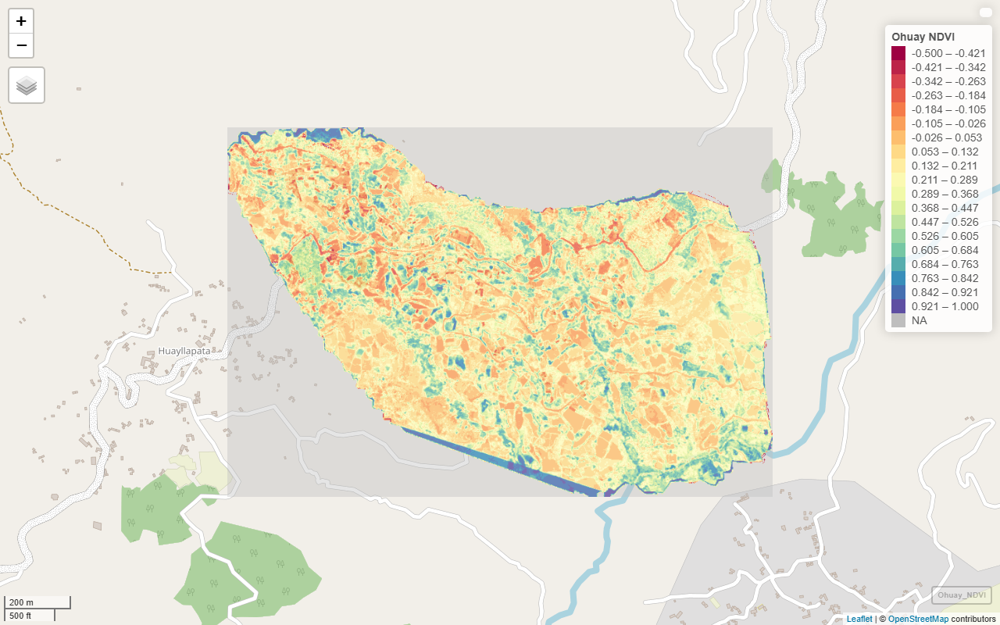

```{r, include = FALSE}
knitr::opts_chunk$set(
  collapse = TRUE,
  comment = "#>",
  eval = FALSE
)
```

*Extracting ultra-high resolution vegetation and water metrics from UAV orthomosaics*

## 1 Objective

Ingest UAV orthomosaic bands (Near-Infrared, Red, and Green) and compute two foundational environmental metrics: Normalized Difference Vegetation Index (NDVI) and Normalized Difference Water Index (NDWI).

<div class="text-center my-3">
  
</div>

---

## 2 Functions from `drones4health`

| Variable / Target | Function | Description |
| :--- | :--- | :--- |
| **Multi-Band Stack Ingestion** | `d4h_read_stack()` | Ingests multi-band raster stacks and verifies that required spectral bands are present, halting with an informative error if any band is missing. |
| **Vegetation Canopy** | `d4h_ndvi()` | Quantifies photosynthetic vigor and vegetative canopy cover from Near-Infrared and Red bands. |
| **Water Detection** | `d4h_ndwi()` | Delineates open standing water surfaces and moisture accumulation from Green and Near-Infrared bands. |
| **Unified Visualization** | `d4h_plot()` | Unified visualization: renders static `ggplot2` maps when `interactive = FALSE`, or interactive web maps via `mapview` when `interactive = TRUE`. |

---

## 3 Workflow

### 3.1 Libraries

We load the core spatial packages and dependencies required for drone remote sensing analysis:

```{r}
library(drones4health)
library(terra)
library(ggplot2)
```

### 3.2 Spatial Data Preparation & Multi-Band Stack Ingestion

We can ingest individual spectral band files or load a multi-band GeoTIFF stack using `d4h_read_stack()`, which automatically validates that all required bands are present:

```{r}
# Option A: Ingest individual drone band GeoTIFF files
path_nir <- "img/Ohuay_NIR.tif"
path_r   <- "img/Ohuay_R.tif"
path_g   <- "img/Ohuay_G.tif"

# Option B: Ingest a multi-band stacked raster with automated band validation
# If any required band is missing, d4h_read_stack halts with an informative error
# r_stack <- d4h_read_stack(
#   file_path      = "img/Ohuay_Stack.tif",
#   required_bands = c("NIR", "Red", "Green")
# )
```

### 3.3 Metric Calculation: NDVI & NDWI

We compute the two environmental indices directly from the raster bands:

```{r}
# 1. Normalized Difference Vegetation Index (NDVI)
# Formula: (NIR - Red) / (NIR + Red)
r_ndvi <- d4h_ndvi(nir = path_nir, red = path_r)

# 2. Normalized Difference Water Index (NDWI)
# Formula: (Green - NIR) / (Green + NIR)
r_ndwi <- d4h_ndwi(green = path_g, nir = path_nir)
```

### 3.4 Unified Visualization (Static & Interactive)

`d4h_plot()` provides a single unified interface: setting `interactive = FALSE` outputs a publication-ready `ggplot2` figure, while `interactive = TRUE` renders an interactive `mapview` web map:

```{r}
# 1. Static publication-ready cartography via ggplot2 (interactive = FALSE)
p_static <- d4h_plot(
  x           = r_ndvi,
  interactive = FALSE,
  palette     = "viridis",
  title       = "UAV Canopy Density (NDVI)",
  limits      = c(-0.1, 0.9)
)
print(p_static)

# 2. Interactive web map exploration via mapview (interactive = TRUE)
m_interactive <- d4h_plot(
  x           = r_ndvi,
  interactive = TRUE,
  palette     = "viridis",
  title       = "UAV Canopy Density (NDVI)"
)
m_interactive
```

<div class="text-center my-3">
  
</div>
