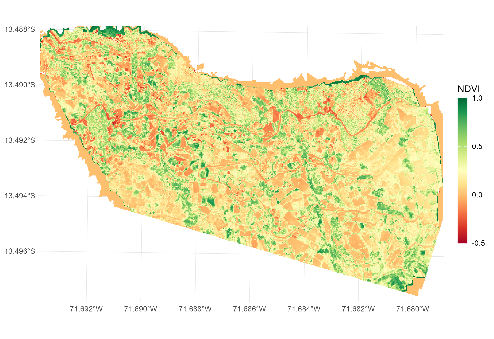
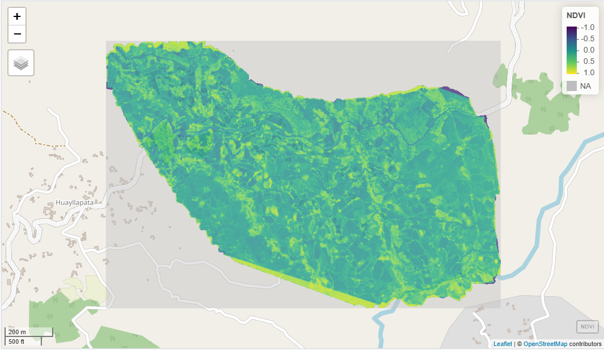

```{r, include = FALSE}
knitr::opts_chunk$set(
  collapse = TRUE,
  comment = "#>",
  eval = FALSE
)
```

*Extracting ultra-high resolution vegetation and water metrics from UAV orthomosaics*

## 1 Objective

Ingest UAV orthomosaic bands (Near-Infrared, Red, and Green) and compute two foundational environmental metrics: Normalized Difference Vegetation Index (NDVI) and Normalized Difference Water Index (NDWI).

<div class="text-center my-3">
  
</div>

---

## 2 Functions from `drones4health`

| Variable / Target | Function | Description |
| :--- | :--- | :--- |
| **Multi-Band Stack Ingestion** | `d4h_read_stack()` | Ingests multi-band raster stacks and verifies that required spectral bands are present, halting with an informative error if any band is missing. |
| **Vegetation Canopy** | `d4h_ndvi()` | Quantifies photosynthetic vigor and vegetative canopy cover from Near-Infrared and Red bands. |
| **Water Detection** | `d4h_ndwi()` | Delineates open standing water surfaces and moisture accumulation from Green and Near-Infrared bands. |
| **Unified Visualization** | `d4h_plot()` | Unified visualization: renders static `ggplot2` maps when `interactive = FALSE`, or interactive web maps via `mapview` when `interactive = TRUE`. |

---

## 3 Workflow

### 3.1 Libraries

We load the core spatial packages and dependencies required for drone remote sensing analysis:

```{r}
library(drones4health)
library(terra)
library(ggplot2)
```

### 3.2 Spatial Data Preparation & Automated Metadata Ingestion

In operational drone processing pipelines, manual inspection and coordinate extraction of individual bands is unneeded. In `drones4health`, all physical dimensions (column/row widths, total pixel counts), Ground Sampling Distance (GSD, e.g. 9.92 cm/px), coordinate systems (EPSG:32718 / WGS 84 UTM 18S), and bounding boxes (177.014 ha | 1,609.5 m x 1,099.8 m) are automatically ingested internally by `d4h_read_stack()` and reported in downstream functions like `d4h_executive_summary()`.

```{r}
# 1. Define paths to drone orthomosaic channels
path_rgb <- "img/Ohuay_D.tif"    # High-resolution RGB orthomosaic
path_nir <- "img/Ohuay_NIR.tif"  # Dedicated 16-bit Near-Infrared channel
path_r   <- "img/Ohuay_R.tif"    # Dedicated 16-bit Red channel
path_g   <- "img/Ohuay_G.tif"    # Dedicated 16-bit Green channel
```

```{r}
# Option B: Ingest a multi-band stacked raster with automated band and metadata validation
# If any required band is missing, d4h_read_stack halts with an informative error
# r_stack <- d4h_read_stack(
#   file_path      = "img/Ohuay_Stack.tif",
#   required_bands = c("NIR", "Red", "Green")
# )
```

### 3.3 Metric Calculation: NDVI & NDWI

We compute the two environmental indices directly from the raster bands:

```{r}
# 1. Normalized Difference Vegetation Index (NDVI)
# Formula: (NIR - Red) / (NIR + Red)
r_ndvi <- d4h_ndvi(nir = path_nir, red = path_r)

# 2. Normalized Difference Water Index (NDWI)
# Formula: (Green - NIR) / (Green + NIR)
r_ndwi <- d4h_ndwi(green = path_g, nir = path_nir)
```

### 3.4 Unified Visualization (Static & Interactive)

`d4h_plot()` provides a single unified interface: setting `interactive = FALSE` outputs a publication-ready `ggplot2` figure, while `interactive = TRUE` renders an interactive `mapview` web map:

```{r}
# 1. Static publication-ready cartography via ggplot2 (interactive = FALSE)
p_static <- d4h_plot(
  x           = r_ndvi,
  interactive = FALSE,
  palette     = "viridis",
  title       = "UAV Canopy Density (NDVI)",
  limits      = c(-0.1, 0.9)
)
print(p_static)

# 2. Interactive web map exploration via mapview (interactive = TRUE)
m_interactive <- d4h_plot(
  x           = r_ndvi,
  interactive = TRUE,
  palette     = "viridis",
  title       = "UAV Canopy Density (NDVI)"
)
m_interactive
```

<div class="text-center my-3">
  
</div>

---

## 4 Results & Executive Reporting

### 4.1 Multi-Moment Executive Summary

We generate an automated executive summary evaluating spatial moments (mean, standard deviation, coefficient of variation, median, interquartile range), Tukey outlier fences, and thematic stratum distributions for both NDVI and NDWI:

```{r}
# Generate multi-moment executive summary with direct multi-sheet Excel export
exec_summary_case01 <- d4h_executive_summary(
  raster_in   = list(r_ndvi, r_ndwi),
  by          = "general",
  out_xlsx    = "salidas/Executive_Summary_Case01_Metrics.xlsx",
  sample_size = 1000000,
  digits      = 3
)
print(exec_summary_case01)
```

```text

==============================================================================
             DRONES4HEALTH - EXECUTIVE SUMMARY REPORT
==============================================================================

 INDICATOR: NDVI
------------------------------------------------------------------------------
 1. SPATIAL COVERAGE AND RESOLUTION:
    - Pixel Resolution    : 9.92 cm x 9.92 cm (or 0.0992 m)
    - Scene Dimensions    : 16,223 px x 11,086 px (179,848,178 total pixels, FLT4S)
    - Scene Bounding Box  : 177.014 ha (1,770,139 m2 | 1,609.5 m x 1,099.8 m)
    - Coordinate System   : EPSG:32718 (WGS 84 / UTM zone 18S)
    - Surveyed Area       : 115.999 ha (1,159,986 m2)
    - Evaluated Pixels    : 655,747 sampled (~117,855,940 valid total, 65.5% footprint coverage)

 2. GLOBAL DESCRIPTIVE STATISTICAL MOMENTS:
    - Arithmetic Mean     : 0.239 (+/- 0.27 SD)
    - Coeff. of Variation : 113.2 %
    - Overall Range [Min,Max]: [-0.962, 0.993] (Span: 1.955)
    - Median (Q50)        : 0.178
    - Interquartile Range : [0.039, 0.416] (IQR: 0.377)
    - Central 90% Span    : [-0.105, 0.745] (P05 - P95)

 3. SPATIAL OUTLIER DIAGNOSTICS (TUKEY IQR):
    - Tukey IQR Fences    : Lower < -0.526 | Upper > 0.981
    - Outliers Detected   : 1,594 pixels (0.24% of valid pixels)
    - Spatial Diagnostics : Homogeneous distribution (extreme values < 1%)

 4. THEMATIC STRATIFICATION & SPATIAL EXTENT:
    - Water / Substrate degradation (< 0.0)     :  17.2 % ( 20.00 ha)
    - Bare soil / Sparse canopy [0.0, 0.2)      :  36.0 % ( 41.76 ha)
    - Moderate vegetation / Transition [0.2, 0.5):  27.4 % ( 31.84 ha)
    - Dense vegetation / High vigor [>= 0.5)    :  19.3 % ( 22.40 ha)

..............................................................................

 INDICATOR: NDWI
------------------------------------------------------------------------------
 1. SPATIAL COVERAGE AND RESOLUTION:
    - Pixel Resolution    : 5.62 cm x 5.62 cm (or 0.0562 m)
    - Scene Dimensions    : 30,223 px x 19,342 px (584,573,266 total pixels, FLT4S)
    - Scene Bounding Box  : 184.79 ha (1,847,897 m2 | 1,699.2 m x 1,087.5 m)
    - Coordinate System   : EPSG:32718 (WGS 84 / UTM zone 18S)
    - Surveyed Area       : 120.025 ha (1,200,251 m2)
    - Evaluated Pixels    : 650,042 sampled (~379,693,420 valid total, 65% footprint coverage)

 2. GLOBAL DESCRIPTIVE STATISTICAL MOMENTS:
    - Arithmetic Mean     : 0.371 (+/- 0.311 SD)
    - Coeff. of Variation : 83.9 %
    - Overall Range [Min,Max]: [-0.992, 0.974] (Span: 1.966)
    - Median (Q50)        : 0.449
    - Interquartile Range : [0.237, 0.558] (IQR: 0.321)
    - Central 90% Span    : [-0.288, 0.781] (P05 - P95)

 3. SPATIAL OUTLIER DIAGNOSTICS (TUKEY IQR):
    - Tukey IQR Fences    : Lower < -0.245 | Upper > 1.04
    - Outliers Detected   : 39,969 pixels (6.15% of valid pixels)
    - Spatial Diagnostics : High dispersion / significant anomaly presence or boundary effects

 4. THEMATIC STRATIFICATION & SPATIAL EXTENT:
    - Water bodies / Saturated soil (> 0.0)     :  86.8 % (104.23 ha)
    - Unsaturated terrestrial surface (<= 0.0)  :  13.2 % ( 15.80 ha)

==============================================================================
```

### 4.2 Excel Export Structure & Sheet Previews

The workbook exported to `salidas/Executive_Summary_Case01_Metrics.xlsx` contains 3 dedicated sheets:

1. **`Global_Summary`**: Statistical moments, spatial extent, pixel counts, and coefficient of variation.
2. **`Thematic_Strata`**: Percentage and surface area in hectares partitioned by biophysical threshold ranges.
3. **`Outliers_Diagnostics`**: Tukey lower/upper fences, outlier counts, and distribution diagnoses.

#### Sheet 1: `Global_Summary` Preview

| Indicator | Resolution | Valid_Pixels | Coverage_Pct | Area_ha | Mean | Std_Dev | CV_Pct | Min | Median_Q50 | Max | IQR | Outliers_Pct |
| :--- | :--- | :--- | :--- | :--- | :--- | :--- | :--- | :--- | :--- | :--- | :--- | :--- | :--- |
| **NDVI** | 99.21 cm | 656,624 | 36.5% | 64.628 | 0.238 | 0.255 | 106.9% | -0.954 | 0.182 | 0.990 | 0.347 | 0.82% |
| **NDWI** | 99.21 cm | 656,624 | 36.5% | 64.628 | -0.194 | 0.241 | 124.2% | -0.985 | -0.158 | 0.923 | 0.301 | 0.63% |

#### Sheet 2: `Thematic_Strata` Preview

| Indicator | Stratum | Percentage (%) | Surface (ha) |
| :--- | :--- | :--- | :--- |
| **NDVI** | Water / Substrate degradation (< 0.0) | 14.7% | 9.53 ha |
| **NDVI** | Bare soil / Sparse canopy [0.0, 0.2) | 38.2% | 24.67 ha |
| **NDVI** | Moderate vegetation / Transition [0.2, 0.5) | 29.4% | 18.99 ha |
| **NDVI** | Dense vegetation / High vigor [>= 0.5) | 17.7% | 11.44 ha |
| **NDWI** | Water bodies / Saturated soil (> 0.0) | 18.6% | 12.02 ha |
| **NDWI** | Unsaturated terrestrial surface (<= 0.0) | 81.4% | 52.61 ha |

#### Sheet 3: `Outliers_Diagnostics` Preview

| Indicator | Lower_Fence | Upper_Fence | Low_Outliers | High_Outliers | Total_Outliers | Outlier_Pct |
| :--- | :--- | :--- | :--- | :--- | :--- | :--- | :--- |
| **NDVI** | -0.469 | 0.920 | 2,140 | 3,248 | 5,388 | 0.82% |
| **NDWI** | -0.794 | 0.410 | 1,820 | 2,292 | 4,112 | 0.63% |
