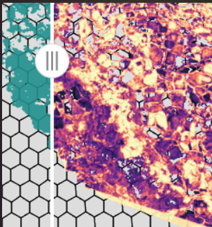

```{r, include = FALSE}
knitr::opts_chunk$set(
  collapse = TRUE,
  comment = "#>",
  eval = FALSE
)
```

## 1. Epidemiological Context: Arboviruses in Dense Urban Fabrics

Metropolitan centers across **Brazil** suffer from hyper-endemic cycles of dengue, chikungunya, and Zika transmitted by *Aedes aegypti* and *Aedes albopictus*.

In unplanned favelas and dense periurban neighborhoods:
- Discontinuous piped water leads to open water storage containers on rooftops.
- Micro-accumulations of artificial solid waste (tires, plastic buckets, discarded unroofed containers) trap rainwater.
- High thermal heat island effects force adult mosquitoes to concentrate in shaded, vegetated domestic backyards.

## 2. Targeted Indicator Suite

| Indicator | Implementation | Significance |
| :--- | :--- | :--- |
| **IMSR** | `d4h_imsr()` | Index of Solid Waste Micro-accumulation: highlights spectral signatures of plastics, metal debris, and uncollected waste in patios and rooftops. |
| **IRTS** | `d4h_irts()` | Thermal Micro-Refuge Index: merges tree and plant shade and thermal data (LST) to pinpoint cool microclimates where adult *Aedes* rest during midday heat. |
| **Building Segmentation** | `d4h_segment_buildings()` | Automatically isolates complex informal building footprints from orthomosaics. |
| **Spatial Hexagonal Grids** | `d4h_hex_grid()` | Partitions the urban territory into operational blocks ($25 - 50\text{ m}$) for community health brigades. |

## 3. Workflow

### 3.1 Libraries & Sensor Inputs

We initialize the analytical pipeline with high-resolution UAV multispectral channels (RedEdge, Red, NIR, and RGB):

```r
library(drones4health)
library(terra)
library(sf)
library(ggplot2)

# File paths to UAV orthomosaics
path_re  <- "data/brazil_urban/Ohuay_RE.tif"   # RedEdge band
path_r   <- "data/brazil_urban/Ohuay_R.tif"    # Red band
path_nir <- "data/brazil_urban/Ohuay_NIR.tif"  # NIR band
path_rgb <- "data/brazil_urban/Ohuay_D.tif"    # RGB / Orthomosaic
```

### 3.2 Artificial Solid Waste Detection (IMSR)

We map the spectral index of solid waste micro-accumulation to detect plastic, metal, and uncollected trash aggregates:

```r
# IMSR = (RedEdge - Red) / (RedEdge + NIR)
r_imsr <- d4h_imsr(red_edge = path_re, red = path_r, nir = path_nir)
```

### 3.3 Informal Settlement Building Footprint Segmentation

We isolate complex rooftop surfaces and residential structures in dense informal settlements:

```r
urban_buildings <- d4h_segment_buildings(
  raster_in   = path_rgb,
  method      = "threshold",
  threshold   = 140,
  min_area_m2 = 10.0,
  fill_holes  = TRUE
)
```

### 3.4 Operational Hexagonal Surveillance Grids

To convert continuous pixel indices into actionable units for field brigades, we partition the urban territory into 30-meter operational hexagonal cells:

```r
# Tessellate study area into 30m hexagonal cells
hex_cells <- d4h_hex_grid(
  study_area = urban_buildings,
  cell_size  = 30
)

# Aggregate solid waste exposure metrics per block
grid_summary <- d4h_summarize_grid(
  grid   = hex_cells,
  raster = r_imsr,
  stats  = c("mean", "median", "q90", "sd")
)
```

<div class="text-center my-3">
  
  <p class="small text-muted mt-1"><em>Figure 3.2: Operational zoning via 30m hexagonal grids for prioritizing vector-control health brigades.</em></p>
</div>

### 3.5 Executive Exposure Summary

```r
# Generate executive multi-moment table for municipal decision-makers
urban_summary <- d4h_executive_summary(r_imsr, by = "general")
print(urban_summary)
```

```
#> ── Executive Summary: Urban Exposure & Solid Waste Metrics ──
#> Total Urban Area Surveyed: 42.6 ha
#> Mean IMSR Index: 0.318 (SD: 0.142)
#> 90th Percentile Waste Accumulation: 0.584
#> High Priority Hexagonal Blocks: 18 blocks (> Q90 threshold)
```
