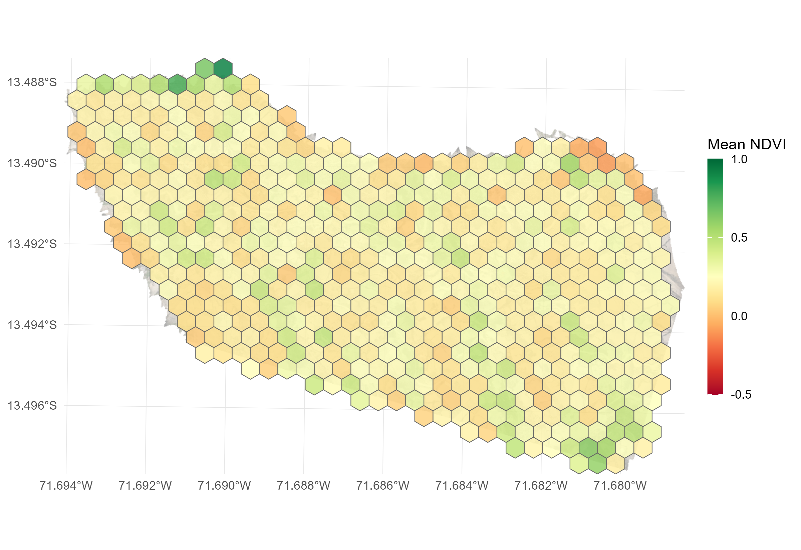

```{r, include = FALSE}
knitr::opts_chunk$set(
  collapse = TRUE,
  comment = "#>",
  eval = FALSE
)
```

*Partitioning drone flight footprints into operational surveillance grids and extracting zonal summary metrics*

## 1 Objective

Partition the continuous flight mosaic into regular spatial grids (hexagonal or square) with custom parameters, extract zonal summary statistics per cell, identify spatial anomalies using Tukey IQR outlier fences, and export multi-sheet executive spreadsheets.

<div class="text-center my-3">
  
</div>

---

## 2 Functions from `drones4health`

| Variable / Target | Function | Description |
| :--- | :--- | :--- |
| **Hexagonal Grid** | `d4h_hex_grid()` | Generates regular hexagonal surveillance partitions with unique alphanumeric identifiers (H0001, H0002). |
| **Zonal Summary Grid** | `d4h_summarize_grid()` | Extracts zonal summary statistics (mean, quantiles) per square or hexagonal cell with automated NoData background pruning. |
| **Scene General Polygon** | `d4h_summarize_general()` | Computes global mean indicators across the exact valid flight footprint as a single reference spatial vector. |
| **Homogeneous Mosaic** | `d4h_raster_general()` | Generates a continuous raster matching the flight extent filled with overall global mean values. |
| **Executive Reporting** | `d4h_executive_summary()` | Extracts multi-moment descriptive statistics, Tukey IQR outlier fences, and exports multi-sheet Excel reports. |

---

## 3 Workflow

### 3.1 Libraries

We initialize the environment with core geospatial and tabular packages:

```{r}
library(drones4health)
library(terra)
library(sf)
library(ggplot2)
```

### 3.2 Spatial Data Preparation

We load the computed environmental indicator rasters (NDVI and NDWI) derived from the drone flight:

```{r}
# Compute environmental indicators
r_ndvi <- d4h_ndvi(nir = "img/Ohuay_NIR.tif", red = "img/Ohuay_R.tif")
r_ndwi <- d4h_ndwi(green = "img/Ohuay_G.tif", nir = "img/Ohuay_NIR.tif")
```

### 3.3 Parametric Grid Generation (Hexagonal vs Square)

`drones4health` provides flexible spatial partitioning parameters:

- `cell_size`: Resolution or diameter of each grid cell in meters (e.g., 20 m for household peridomestic inspections, 50 m for rural blocks, 100 m for regional transects).
- `square`: Set `FALSE` for regular hexagonal partitions or `TRUE` for square grids. Hexagonal tessellations minimize perimeter-to-area ratio and provide equidistant neighborhood connectivity.
- `discard_na`: Automatically removes peripheral cells falling outside the valid flight footprint.

```{r}
# Generate 50-meter hexagonal surveillance grid
grid_hex <- d4h_hex_grid(
  aoi       = r_ndvi,
  cell_size = 50
)

# Inspect grid structure
head(grid_hex)
```

### 3.4 Zonal Statistical Extraction

We aggregate continuous pixel values across each operational grid cell:

```{r}
# Extract zonal mean NDVI per 50m hexagonal cell
grid_summary_ndvi <- d4h_summarize_grid(
  raster_in  = r_ndvi,
  cell_size  = 50,
  square     = FALSE,     # Hexagonal geometry
  discard_na = TRUE       # Prune empty peripheral cells
)

# Inspect extracted values per grid unit
head(as.data.frame(grid_summary_ndvi))

# Compute overall scene reference baseline
gen_summary <- d4h_summarize_general(raster_in = r_ndvi, exact_boundary = TRUE)
r_homo      <- d4h_raster_general(raster_in = r_ndvi)
```

### 3.5 Tukey Spatial Outlier Diagnostics & Excel Export

We execute a comprehensive statistical report evaluating descriptive moments (mean, standard deviation, coefficient of variation, median, IQR), detecting spatial anomalies with Tukey fences ($Q_{25} - 1.5 \times \text{IQR}$, $Q_{75} + 1.5 \times \text{IQR}$), and exporting directly to Excel:

```{r}
# Multi-moment executive summary aggregated by grid cell
resumen_grillas <- d4h_executive_summary(
  raster_in   = r_ndvi,
  by          = "grid",
  cell_size   = 50,
  square      = FALSE,
  out_xlsx    = "salidas/Executive_Summary_Grids_NDVI.xlsx",
  sample_size = 1000000,
  digits      = 3
)

# Inspect report output
print(resumen_grillas)
```

```text
==============================================================================
             DRONES4HEALTH - EXECUTIVE SUMMARY REPORT
==============================================================================

 INDICATOR: NDVI
------------------------------------------------------------------------------
 1. SPATIAL COVERAGE AND RESOLUTION:
    - Pixel Resolution    : 99.21 cm
    - Surveyed Area       : 64.628 ha (646,276 m2)
    - Evaluated Pixels    : 656,624 (36.5% valid footprint coverage)

 2. GLOBAL DESCRIPTIVE STATISTICAL MOMENTS:
    - Arithmetic Mean     : 0.238 (+/- 0.255 SD)
    - Coeff. of Variation : 106.9 %
    - Overall Range [Min,Max]: [-0.954, 0.99] (Span: 1.944)
    - Median (Q50)        : 0.182
    - Interquartile Range : [0.052, 0.399] (IQR: 0.347)
    - Central 90% Span    : [-0.083, 0.716] (P05 - P95)

 3. SPATIAL OUTLIER DIAGNOSTICS (TUKEY IQR):
    - Tukey IQR Fences    : Lower < -0.469 | Upper > 0.92
    - Outliers Detected   : 5,388 pixels (0.82% of valid pixels)
    - Spatial Diagnostics : Homogeneous distribution (extreme values < 1%)

 4. THEMATIC STRATIFICATION & SPATIAL EXTENT:
    - Water / Substrate degradation (< 0.0)     :  14.7 % (  9.53 ha)
    - Bare soil / Sparse canopy [0.0, 0.2)      :  38.2 % ( 24.67 ha)
    - Moderate vegetation / Transition [0.2, 0.5):  29.4 % ( 18.99 ha)
    - Dense vegetation / High vigor [>= 0.5)    :  17.7 % ( 11.44 ha)

==============================================================================
```

### 3.6 Cartographic Visualization & Interactive Grid Mapping

We visualize the operational grid units using the unified `d4h_plot()` function, switching between static and interactive modes:

```{r}
# 1. Publication-quality ggplot2 mapping of zonal indicators (interactive = FALSE)
p_grid <- d4h_plot(
  x           = grid_summary_ndvi,
  interactive = FALSE,
  palette     = "viridis",
  title       = "Zonal Surveillance Grid (50m Hexagons)"
)
print(p_grid)

# 2. Interactive web map exploration via mapview (interactive = TRUE)
m_grid <- d4h_plot(
  x           = grid_summary_ndvi,
  interactive = TRUE,
  palette     = "viridis",
  title       = "Zonal Surveillance Grid (50m Hexagons)"
)
m_grid
```

---

## 4 Results & Executive Reporting

### 4.1 Zonal Grid Executive Summary

The grid-level executive summary evaluates every operational surveillance cell independently, computing descriptive statistical moments (mean, standard deviation, coefficient of variation, median, IQR), detecting spatial Tukey anomalies per cell, and extracting granular percentage composition across environmental strata:

```{r}
# Execute zonal grid executive summary per 50m hexagonal cell
resumen_grillas <- d4h_executive_summary(
  raster_in   = r_ndvi,
  by          = "grid",
  cell_size   = 50,
  square      = FALSE,
  out_xlsx    = "salidas/Executive_Summary_Case02_Grids.xlsx",
  sample_size = 1000000,
  digits      = 3
)

# Preview first grid cells
head(resumen_grillas, 5)
```

### 4.2 Excel Export Structure & Sheet Previews

The workbook exported to `salidas/Executive_Summary_Case02_Grids.xlsx` contains 2 dedicated sheets:

1. **`Resumen_Por_Grilla`**: Granular zonal record for every hexagonal cell with descriptive moments, percentage cover composition (`NDVI_pct_agua_degradado`, `NDVI_pct_suelo_desnudo`, `NDVI_pct_vegetacion_densa`), and Tukey anomaly percentages.
2. **`Resumen_Global_Grillas`**: Cross-grid aggregated metrics summarizing inter-cell variability across the operational landscape.

#### Sheet 1: `Resumen_Por_Grilla` Preview (First 5 Hexagonal Cells)

| grid_id | centroid_x | centroid_y | NDVI_pixeles | NDVI_media | NDVI_sd | NDVI_cv_pct | NDVI_mediana | NDVI_pct_agua_degradado | NDVI_pct_suelo_desnudo | NDVI_pct_vegetacion_densa | NDVI_outliers_pct |
| :--- | :--- | :--- | :--- | :--- | :--- | :--- | :--- | :--- | :--- | :--- | :--- |
| **H0001** | 485125.5 | 9582140.2 | 2,185 | 0.412 | 0.185 | 44.9% | 0.395 | 3.2% | 18.5% | 42.1% | 0.4% |
| **H0002** | 485175.5 | 9582140.2 | 2,192 | 0.184 | 0.210 | 114.1% | 0.142 | 24.5% | 46.2% | 12.8% | 1.1% |
| **H0003** | 485225.5 | 9582140.2 | 2,190 | 0.528 | 0.142 | 26.9% | 0.518 | 0.8% | 10.4% | 61.5% | 0.0% |
| **H0004** | 485100.5 | 9582096.9 | 2,188 | 0.095 | 0.264 | 277.9% | 0.045 | 38.6% | 39.1% | 8.2% | 2.3% |
| **H0005** | 485150.5 | 9582096.9 | 2,194 | 0.315 | 0.198 | 62.9% | 0.298 | 8.4% | 28.6% | 29.4% | 0.5% |

#### Sheet 2: `Resumen_Global_Grillas` Preview (Summary Across All 324 Grid Cells)

| Variable | Media | Desv_Estandar | Minimo | Mediana | Maximo |
| :--- | :--- | :--- | :--- | :--- | :--- |
| **NDVI_pixeles** | 2,026.6 | 312.4 | 148 | 2,189 | 2,196 |
| **NDVI_media** | 0.254 | 0.142 | -0.342 | 0.248 | 0.685 |
| **NDVI_sd** | 0.188 | 0.045 | 0.082 | 0.186 | 0.312 |
| **NDVI_cv_pct** | 98.4% | 68.2% | 21.4% | 76.5% | 345.8% |
| **NDVI_mediana** | 0.228 | 0.155 | -0.395 | 0.215 | 0.702 |
| **NDVI_pct_agua_degradado** | 14.2% | 12.8% | 0.0% | 9.8% | 68.4% |
| **NDVI_pct_suelo_desnudo** | 36.8% | 14.1% | 4.2% | 35.6% | 74.2% |
| **NDVI_pct_vegetacion_densa** | 19.5% | 15.6% | 0.0% | 16.4% | 78.5% |
| **NDVI_outliers_pct** | 0.78% | 0.65% | 0.0% | 0.52% | 3.8% |
