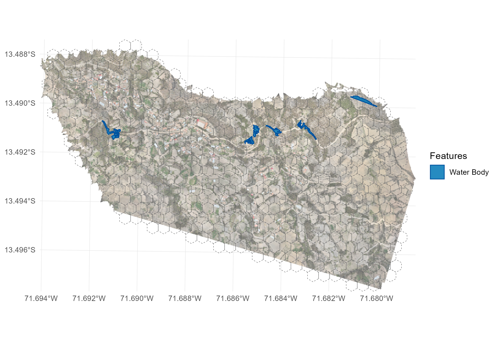

```{r, include = FALSE}
knitr::opts_chunk$set(
  collapse = TRUE,
  comment = "#>",
  eval = FALSE
)
```

*Automated extraction of water bodies, building delineation, and operational grid aggregation*

## 1 Context

Environmental characteristics of the study area include:

- Micro-topographic drainage sinks and slow-moving stream margins.
- Artificial water depressions created by excavations, irrigation trenches, and ponds.
- Clustered rural dwellings situated in close proximity to standing water bodies.
- High spatial heterogeneity where residential roofs and natural vegetation intermix.

### 1.1 Objective

Automatically segment surface water bodies and residential building footprints from drone orthomosaics, summarize physical dimensions (counts, areas in square meters, perimeters), and intersect both feature classes with an operational surveillance grid to quantify how many houses and water bodies exist per grid cell.

<div class="text-center my-3">
  
</div>

---

## 2 Functions from `drones4health`

| Variable / Target | Function | Description |
| :--- | :--- | :--- |
| **Water Body Segmentation** | `d4h_segment_water()` | Detects and vectorizes surface water pools using spectral thresholding or Deep Learning (SAM), with optical darkness filtering to avoid metal roof confusion. |
| **Building Footprint Delineation** | `d4h_segment_buildings()` | Extracts house roofs and structure centroids by integrating RGB brightness thresholds and vegetation masks. |
| **Surveillance Tessellation** | `d4h_hex_grid()` | Creates regular hexagonal spatial partitions across the study area. |
| **Distance to Water Modeling** | `d4h_distance_to_water()` | Computes Euclidean distances and proximity scores from structures to aquatic sources. |

---

## 3 Workflow

### 3.1 Libraries

We load the required spatial, analysis, and data manipulation libraries:

```{r}
library(drones4health)
library(terra)
library(sf)
library(ggplot2)
library(dplyr)
```

### 3.2 Spatial Data Preparation

We load the orthomosaic bands and compute intermediate spectral layers (NDWI and NDVI) used to guide object-based segmentation:

```{r}
# Define input paths to drone imagery
path_rgb <- "img/Ohuay_D.tif"
path_nir <- "img/Ohuay_NIR.tif"
path_r   <- "img/Ohuay_R.tif"
path_g   <- "img/Ohuay_G.tif"

# Calculate spectral indices for water and canopy discrimination
r_ndwi <- d4h_ndwi(green = path_g, nir = path_nir)
r_ndvi <- d4h_ndvi(nir = path_nir, red = path_r)
```

### 3.3 Automated Water Body Segmentation

`d4h_segment_water()` isolates water surfaces while preventing bright reflective metal roofs from being misclassified as water through optical brightness clamping:

```{r}
# Segment water bodies with optical brightness protection and geometric filters
water_sf <- d4h_segment_water(
  raster_in            = r_ndwi,
  rgb_raster           = path_rgb,     # Optical brightness constraint
  threshold            = 0.0,          # NDWI threshold for water delineation
  is_ndwi              = TRUE,
  max_water_brightness = 95.0,         # Excludes shiny metal roofs
  min_area_m2          = 2.0,          # Minimum pool area (filters noise)
  max_area_m2          = 50000.0,      # Maximum water body area
  method               = "spectral"    # "spectral" or "sam"
)

# Inspect detected water polygons
print(water_sf)
```

### 3.4 Residential Building Footprint Segmentation

We extract residential dwellings and structures using visible contrast and vegetation masking:

```{r}
# Segment residential house footprints and centroids
buildings_sf <- d4h_segment_buildings(
  rgb_raster     = path_rgb,
  ndvi_raster    = r_ndvi,
  min_area_m2    = 12.0,
  max_area_m2    = 600.0,
  brightness_min = 135.0,
  ndvi_max       = 0.25,
  method         = "spectral"
)

# Inspect detected building polygons
print(buildings_sf)
```

### 3.5 Segmentation Summary & Spatial Grid Intersection

We summarize the overall segmented features and intersect them with an operational 50 m surveillance grid to determine the exact number of houses and water bodies per cell:

```{r}
# 1. Summary of segmented features across the entire flight extent
cat("=== SEGMENTED WATER BODIES SUMMARY ===\n")
cat("Total water bodies detected:", nrow(water_sf), "\n")
cat("Total water surface area:", round(sum(water_sf$area_m2), 2), "m² (",
    round(sum(water_sf$area_m2) / 10000, 3), "ha)\n")
cat("Mean pool area:", round(mean(water_sf$area_m2), 2), "m²\n\n")

cat("=== SEGMENTED DWELLINGS SUMMARY ===\n")
cat("Total residential structures detected:", nrow(buildings_sf), "\n")
cat("Total built roof area:", round(sum(buildings_sf$area_m2), 2), "m²\n\n")

# 2. Generate operational 50m hexagonal grid
grid_hex <- d4h_hex_grid(aoi = r_ndvi, cell_size = 50)
grid_sf  <- sf::st_as_sf(grid_hex)

# 3. Aggregate water bodies per grid cell
water_cents <- sf::st_centroid(water_sf)
water_join  <- sf::st_join(water_cents, grid_sf)
water_counts <- water_join |>
  sf::st_drop_geometry() |>
  group_by(grid_id) |>
  summarise(
    n_water_bodies   = n(),
    total_water_area = sum(area_m2, na.rm = TRUE)
  )

# 4. Aggregate residential houses per grid cell
build_cents <- sf::st_centroid(buildings_sf)
build_join  <- sf::st_join(build_cents, grid_sf)
build_counts <- build_join |>
  sf::st_drop_geometry() |>
  group_by(grid_id) |>
  summarise(
    n_houses          = n(),
    total_built_area  = sum(area_m2, na.rm = TRUE)
  )

# 5. Consolidate combined metrics into the spatial grid
grid_analysis <- grid_sf |>
  left_join(water_counts, by = "grid_id") |>
  left_join(build_counts, by = "grid_id") |>
  mutate(
    n_water_bodies   = coalesce(n_water_bodies, 0L),
    total_water_area = round(coalesce(total_water_area, 0), 1),
    n_houses         = coalesce(n_houses, 0L),
    total_built_area = round(coalesce(total_built_area, 0), 1),
    # Priority classification: cells with co-occurring dwellings and water bodies
    priority_tier = case_when(
      n_water_bodies >= 2 & n_houses >= 1 ~ "High Priority",
      n_water_bodies >= 1 & n_houses >= 1 ~ "Moderate Priority",
      n_water_bodies >= 1 & n_houses == 0 ~ "Water Source Focus",
      n_water_bodies == 0 & n_houses >= 1 ~ "Settlement Monitoring",
      TRUE                                ~ "Baseline"
    )
  )

head(sf::st_drop_geometry(grid_analysis), 10)
```

### 3.6 Priority Zonation & Vector Surveillance Mapping

We generate cartographic visualizations highlighting operational cells prioritized for immediate vector surveillance interventions:

```{r}
# Thematic map of surveillance cells stratified by intervention priority
ggplot() +
  geom_sf(data = grid_analysis, aes(fill = priority_tier), alpha = 0.65, color = "gray40") +
  geom_sf(data = water_sf, fill = "#1f78b4", color = "#08519c", alpha = 0.8) +
  geom_sf(data = buildings_sf, fill = "#e31a1c", color = "black", size = 0.3) +
  scale_fill_manual(
    name = "Surveillance Priority",
    values = c(
      "High Priority"         = "#d73027",
      "Moderate Priority"     = "#fc8d59",
      "Water Source Focus"    = "#fee08b",
      "Settlement Monitoring" = "#e0f3f8",
      "Baseline"              = "#ffffff"
    )
  ) +
  theme_minimal() +
  labs(
    title    = "Operational Vector Surveillance Zonation",
    subtitle = "Hexagonal surveillance cells stratified by dwelling and water body co-occurrence",
    caption  = "Data: Ultra-high resolution UAV orthomosaic - drones4health"
  )
```
